# Stellaluna schematics

One sheet per circuit, drawn from [netlist.md](netlist.md). Where changes are proposed, the as-built sheet comes first, then each proposal on its own, then proposals combined; new or changed parts are pink. The same sheets, with a toggle for each proposal, header pinouts and a parts list, are in [schematics.html](schematics.html) (download it and open it in a browser).

Designators use the value codes (R1 = 10k, C4 = 3.3µF, ...), so a code appears wherever that value is used.

## Proposed changes

- **Audio:** ESP32 sidetone: add GPIO26 (DAC2) → C5 1µF → R5 2.2k onto the D52 net for an own-keying sidetone from the ESP32, and a sidetone key line (Mega D46 → 10k / 22k divider → ESP32 GPIO21) that tells it when to sound. Firmware setting st.src (Mega / Adapter / Auto).
- **Audio:** Amp drives headphones: HP_NODE goes straight to the amp input, the amp output drives the jack’s tip and ring, and the speaker moves to the jack’s switched contact (T′). Makes VBand audio as loud in the headphones as on the speaker; no new parts.
- **Latch:** Add T3 with R1 10k from Mega D44 and R8 1M base to GND, collector on the gate node: the keyer can power the ESP32 on.
- **KiCad v1:** Power-path stage on the barrel input, so the barrel supply and the Mega’s USB can never feed each other.
- **KiCad v1:** Link dividers 10k / 20k (3.33V) instead of 10k / 22k (3.44V).

## Sheet 1: Power

*HAT.* The barrel jack feeds one +5V rail through the fuse. Everything runs from that rail except the ESP32, which gets its 5V from the latch.

**As built**

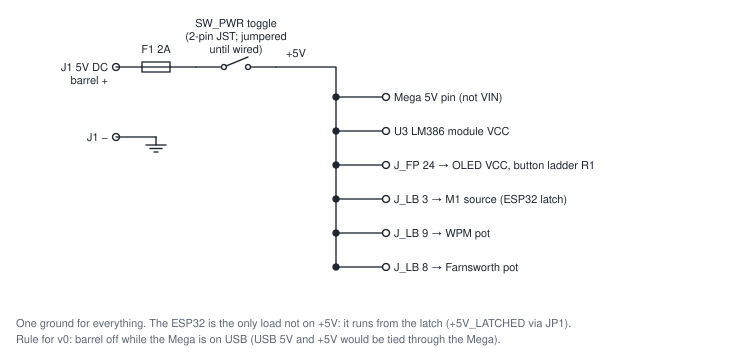

**Proposed: Power path**

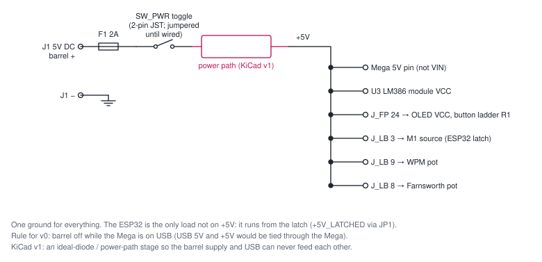

## Sheet 2: ESP32 power latch

*LB · HAT.* A P-channel MOSFET switches the ESP32’s 5V. The button turns it on, the ESP32 holds it on through T1, and the same button doubles as the channel button.

**As built**

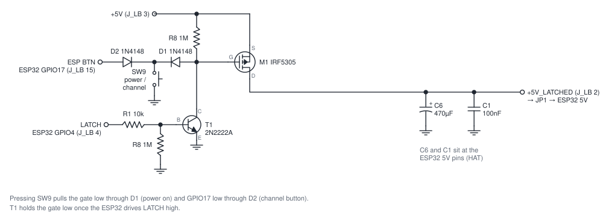

**Proposed: Power-on from the Mega**

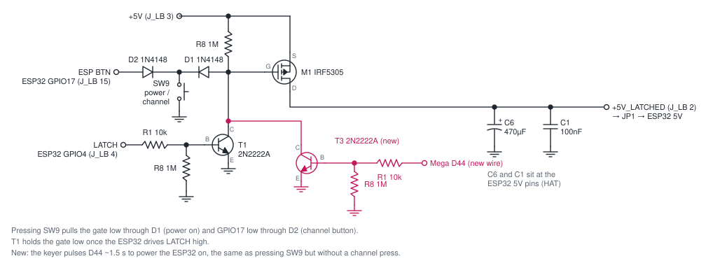

## Sheet 3: Mega ↔ ESP32 link

*HAT.* Serial link at 38400 baud plus the VBand key line. The Mega’s 5V outputs reach the ESP32 through dividers.

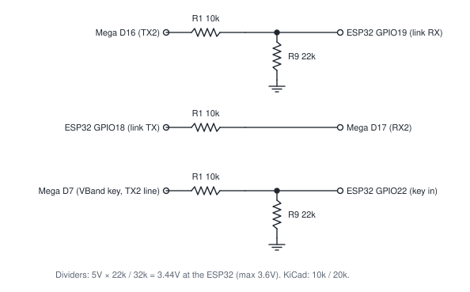

## Sheet 4: Audio

*HAT · FP.* The Mega sidetone feeds the main volume (headphones and speaker) and the line out. Received VBand audio from the ESP32 joins at the headphone point only.

**As built**

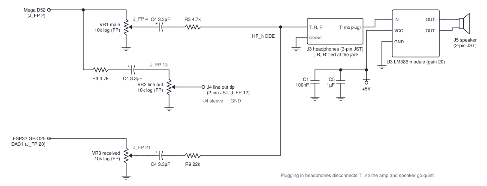

**Proposed: Amp drives headphones**

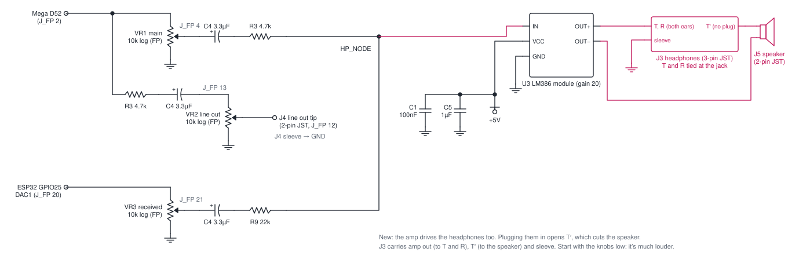

**Proposed: ESP32 sidetone**

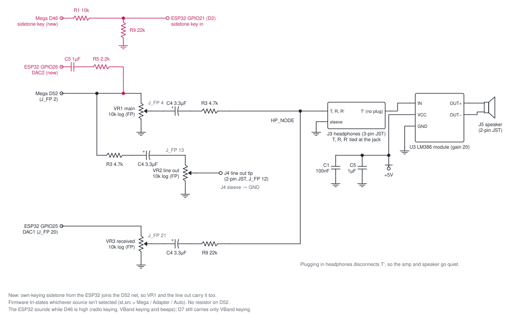

**Proposed: Amp drives headphones + ESP32 sidetone**

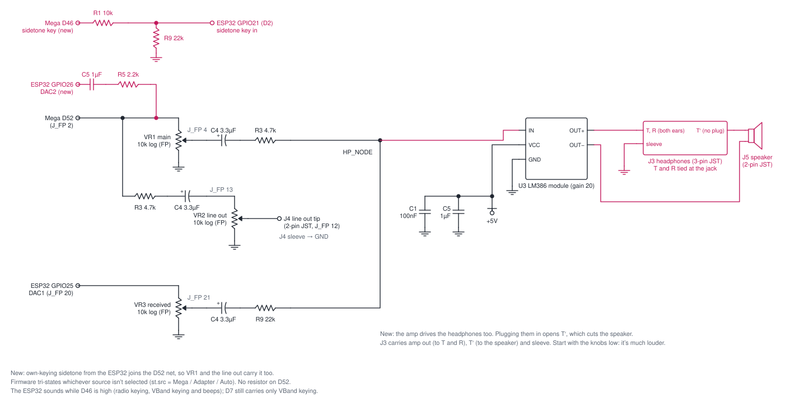

## Sheet 5: Paddle and speed pots

*HAT · LB.* Paddle on D30 (dit, tip) and D32 (dah, ring). The speed pots are on the latch board; their 10nF caps sit at the Mega pins.

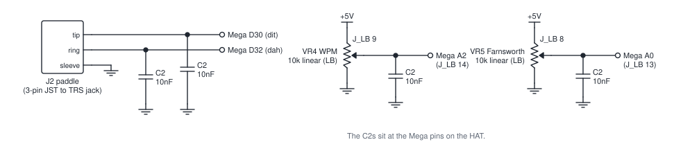

## Sheet 6: Button ladder

*FP.* Eight buttons on one analog pin. The command button sits directly on A1; each one after it is 1k further down the chain.

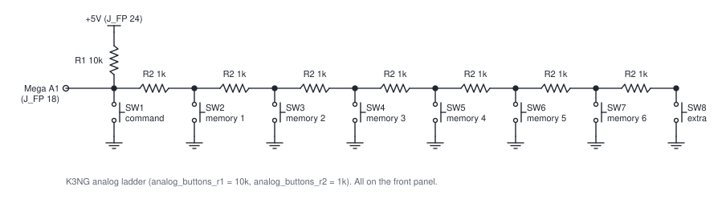

## Sheet 7: LEDs and OLED

*FP · HAT.* Status LEDs driven straight from pins through their resistors, and the I2C OLED.

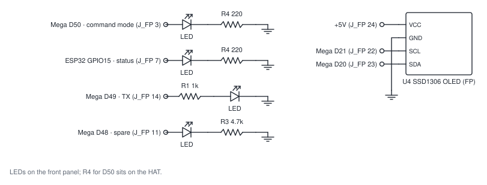

## Sheet 8: TX keying and straight key

*HAT.* The transistor that keys the radio from D49, and the straight key jack. Both are part of the build; they just aren’t wired up yet.

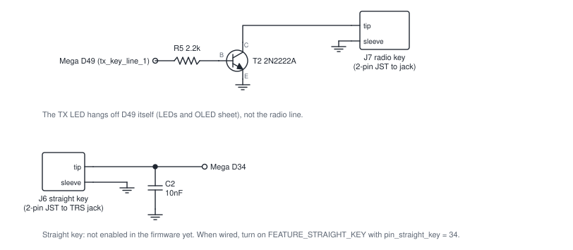
